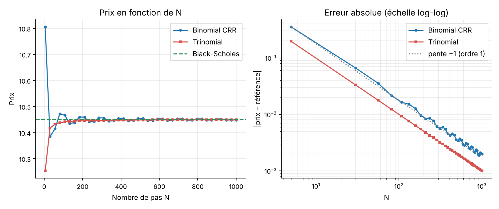
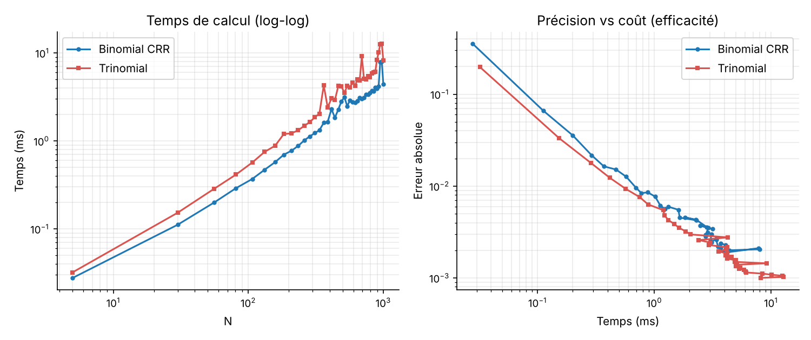

# Évaluation d'options européennes par arbres binomial et trinomial

Projet réalisé par **Reda Erraoui** — ENSA Agadir, filière Finance et Ingénierie Décisionnelle (2026–2027), sous l'encadrement de Pr. B. El Asri.

**[Essayer le simulateur en ligne](https://redaerraoui.github.io/simulateurs/arbres.html)** · **[Lire le rapport (PDF)](rapport.pdf)**

## Problématique

Comment les méthodes numériques par arbres recombinants approchent-elles le prix analytique de Black–Scholes–Merton, à quelle vitesse, et pour quel coût de calcul ?

Le projet compare trois méthodes de valorisation d'une option européenne (call ou put) :

| Méthode | Principe | Complexité |
|---|---|---|
| Black–Scholes–Merton | Formule fermée, sert de référence | O(1) |
| Arbre binomial de Cox–Ross–Rubinstein (CRR) | `u = exp(σ√Δt)`, `d = 1/u`, induction arrière | O(N²) en temps, O(N) en mémoire |
| Arbre trinomial de Boyle | `u = exp(σ√(2Δt))`, trois branches, induction arrière | O(N²) en temps, O(N) en mémoire |

## Principaux résultats

Cas de référence : `S₀ = K = 100`, `T = 1`, `r = 5 %`, `σ = 20 %`, `q = 0`.

- **Convergence d'ordre 1.** Les régressions log-log de l'erreur sur N donnent des pentes proches de −1 (environ −0,98 pour CRR et −1,00 pour Boyle). À N = 1000, l'erreur est d'environ 2×10⁻³ pour CRR et 1×10⁻³ pour Boyle.
- **Équivalence Trinomial(N) = CRR(2N).** Avec la calibration retenue, les probabilités de Boyle s'écrivent `pu = p²`, `pm = 2p(1−p)`, `pd = (1−p)²` : un pas trinomial regroupe deux demi-pas binomiaux. Numériquement, l'écart entre les deux prix est de l'ordre de 10⁻¹².
- **Coût de calcul.** Les deux arbres sont en O(N²), mais l'arbre de Boyle est 1,2 à 1,6 fois plus lent à N égal dans l'implémentation vectorisée NumPy. À précision comparable, les deux méthodes semblent donc proches en coût.





*Figures générées avec `pricing_options.py`, call européen, cas de référence.*

## Application

`pricing_options.py` est une application Tkinter qui permet de :

- calculer les prix Black–Scholes, CRR et Boyle pour un N donné, avec écarts absolus et relatifs et temps de calcul ;
- lancer une étude de convergence et de temps sur une grille de N, dans un thread séparé ;
- vérifier que les probabilités de transition restent dans [0, 1] ;
- choisir parmi cinq scénarios (à la monnaie, dans la monnaie, hors de la monnaie, forte volatilité, courte maturité) ;
- exporter les résultats en CSV, en tableaux LaTeX et en figures PDF/PNG.

### Lancement

```bash
pip install -r requirements.txt
python pricing_options.py
```

Tkinter est fourni avec Python sur Windows et macOS. Sous Linux : `sudo apt install python3-tk`.

## Structure

```
pricing-options-arbres/
├── pricing_options.py   # moteur de calcul + interface graphique
├── requirements.txt
├── figures/             # graphiques du cas de référence
└── rapport.pdf          # rapport complet (47 pages)
```

## Contact

Reda Erraoui · [Portfolio](https://redaerraoui.github.io) · redaerraouie@gmail.com
